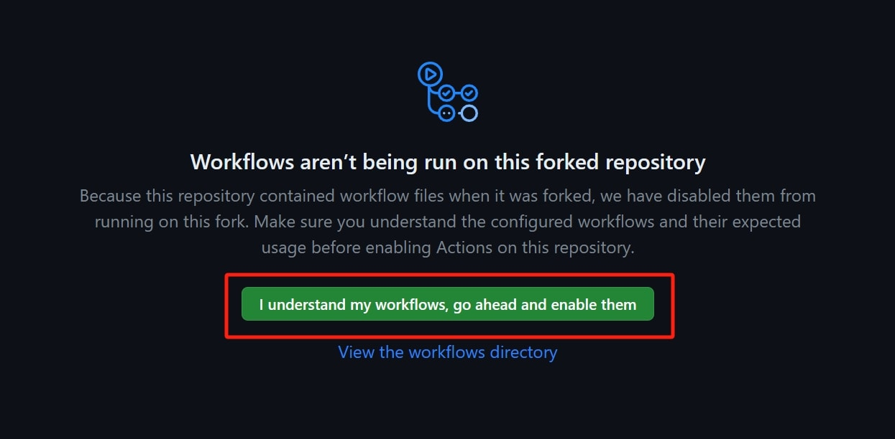
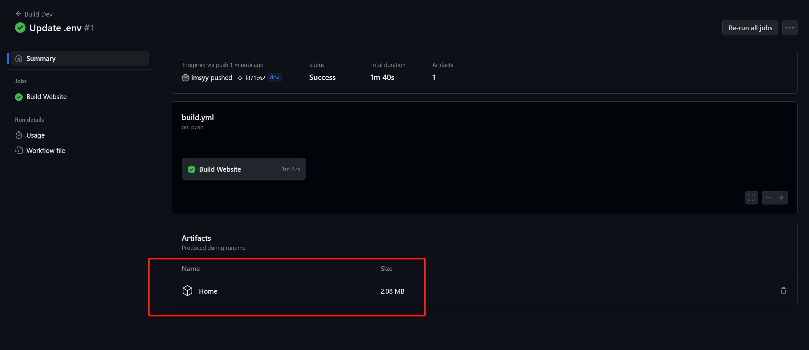

<div align="center">

# 無名の主页 (EFU)

**简体中文** | [English](./README_EN.md)

<p>
  <a title="Vue" target="_blank" href="https://cn.vuejs.org/"></a>
  <a title="Vite" target="_blank" href="https://cn.vitejs.dev/"></a>
  <a title="TypeScript" target="_blank" href="https://www.typescriptlang.org/zh/"></a>
  <a title="Copyright" target="_blank" href="https://nanorocky.top/"></a>
</p>

</div>

---

> [!IMPORTANT]
> ### 致大家
> - 嘿！恭喜你看到这里~ 这是 **酪灰（NanoRocky）** 基于原作者 [imsyy](https://github.com/imsyy/) 个人主页维护的扩展功能修改版（EFU）！修改版新增了逐字歌词、多语言国际化、快捷搜索、本地便签、季节特效等大量功能，同时持续跟进依赖升级与安全性更新（注：开启逐字歌词与季节特效会带来相对更高的性能占用）。
> - 酪灰作为 Vue 初学者，因为热爱拉着同学 [Pizero](https://github.com/pizeroLOL/) 一起完善了这个项目，代码或许不够完美，也可能存在尚未发现的 BUG。欢迎遇到问题时积极反馈，也欢迎各位大佬指点与贡献 PR！
> - **关于问题反馈与求助**：遇到 BUG 请在 GitHub 提交 **Issue**，使用求助请在 GitHub 发起 **Discussion**，看到后会回复。除特殊情况外，**请不要直接通过其它社交渠道私聊联系酪灰**！酪灰不是客服，不提供一对一售后服务，也没有足够精力逐一回复私聊，还请谅解！
> - **最后，如果喜欢本项目的话，麻烦点亮右上角的 ⭐ Star 支持一下！阿里嘎多~**

---

> [!WARNING]
> ### 兼容性警告
> - 我们发现使用 `小米浏览器` 访问时，会造成歌词组件严重掉帧，渲染异常，甚至音乐无法加载的问题，目前原因未知。
> - 除 `小米浏览器` 外，在 `Microsoft Edge` / `Google Chrome` / `Firefox` / `Samsung Browser` / `QQ 浏览器` / `Vivo 浏览器` 测试一切正常。
> - 本项目不兼容 `Internet Explorer` 。

---

## 📸 界面预览


## 👀 在线预览

**Demo**：
- [酪灰の主页](https://nanorocky.top/)（注：酪灰的个人主页运行的是私有分支配置，部分壁纸与细节与公开版略有差异。这些可能是私有配置，或是还未推送的功能改进。）
- [無名の主页 by EFU](https://imhmpv.main.nanorocky.top/) （该预览页面始终自动与 EFU 分支同步）
- [無名の主页](https://imsyy.top/) （原作者的主页，不再作为参考）

> [!TIP]
> - 由于开启了 Workbox（PWA）本地缓存，站点更新后可能需要按 `Ctrl + F5` 强制刷新才能立即看到最新效果。
---

## 🎉 功能特性

- [x] **流畅载入动画与毛玻璃卡片 UI**：支持桌面端与移动端响应式布局适配
- [x] **多语言国际化（i18n）**：内置 **简体中文 / English / 日本語**，支持自动识别浏览器语言及站点自定义英文名/链接翻译
- [x] **多模式主题切换**：支持跟随系统、跟随时间、跟随壁纸自动取色、浅色模式、深色模式
- [x] **季节氛围特效与纪念日默哀**：内置冬日飘雪、秋夜萤火虫、春节灯笼特效
- [x] **快捷搜索框（`Alt + Q`）**：支持多搜索引擎快速切换与网址直达
- [x] **本地多标签便签（`Alt + N`）**：支持新建多篇便签、本地自动持久化、JSON 导入导出、拖拽调整窗口及底栏歌词自动避让
- [x] **时间与时光胶囊**：实时时钟、Hitokoto 一言、日/周/月/年时光进度条及建站天数统计
- [x] **多源实时天气**：支持腾讯位置服务、高德开放平台、Google Weather（海外）及免 Key 备用天气接口自动降级
- [x] **增强型音乐播放器与逐字歌词**：
  - 支持网易云音乐 / QQ 音乐双歌单合并播放与底栏可拖拽进度条
  - 支持 YRC / QRC 逐字歌词解析、增强动效与进度提示点
  - 支持接入 **AMLL TTML Database**（含镜像加速）及跨平台歌词匹配补全
  - 支持翻译歌词同步显示、歌词首尾元数据智能剥离、中键双击/长按还原外部歌词
- [x] **网页语音交互**：支持本地预生成通知语音播报 + TTS 接口实时歌名播报

### ⌨️ 常用快捷操作

| 操作 / 快捷键 | 功能说明 |
| :--- | :--- |
| `Alt + Q` | 呼出 / 收起快捷搜索框（`Esc` 关闭） |
| `Alt + N` | 呼出 / 收起本地便签面板（音乐暂停时 `PgUp / PgDn` 可翻页） |
| `鼠标中键单击`（空白处） | 开启 / 退出壁纸展示预览模式 |
| `鼠标中键双击` / `移动端长按`（底栏歌词） | 当加载了外部源歌词时，丢弃外部歌词并恢复本源歌词 |
---

## ⚙️ 部署指南

> [!TIP]
> - 如果您的部署环境不需要 Workbox 本地缓存（例如已配置 CDN 缓存），或遇到访问子路径自动跳回主页的问题，可在 `vite.config.ts` 中取消注释以下两行配置：
>   ```ts
>   selfDestroying: true,
>   injectRegister: false,
>   ```

### 1. 配置文件说明（重要）

仓库根目录自带一份默认配置模板 `/.env`（请勿删除，否则会触发文件损坏保护提示）。  
在进行自定义配置时，**请将 `/.env` 复制一份并重命名为 `/.env.local`**，然后在 `/.env.local` 中修改您的自定义配置。

### 2. 本地 / 手动构建部署

1. **准备运行环境**（详见 `package.json` 中的 `engines` 约束）：
   - [Git](https://git-scm.com/)
   - [Node.js](https://nodejs.org/zh-cn/)：`>= 24.22.2 < 25` 或 `>= 26.13.0`
   - `pnpm`：`>= 12.14.0`

2. **拉取源码、安装依赖并构建**：

```bash
# 仅克隆 EFU 分支源码并进入目录
git clone -b EFU --single-branch https://github.com/NanoRocky/home.git
cd home

# 全局安装或启用 pnpm
corepack enable
corepack prepare pnpm@latest --activate

# 复制生成本地用户配置文件并按需编辑
cp .env .env.local

# 安装项目依赖
pnpm install

# 本地开发预览
pnpm dev

# 生产环境打包构建
pnpm build
```

> 构建完成后，静态资源将生成在 **`dist`** 目录中，将 `dist` 目录下的全部文件上传至 Nginx / 静态服务器即可。

### 3. GitHub Actions 自动构建

如果本地构建环境受限，可使用仓库内置的 `GitHub Actions` 自动打包：

1. 点击右上角 **Fork** 本仓库后，进入您仓库的 `Actions` 页面并点击开启工作流：
   
2. 按需修改配置并提交代码后会自动触发构建工作流；构建完成后，在工作流页面底部下载生成的静态资源压缩包并上传至服务器即可：
   

### 4. Docker 部署

项目默认监听 `12445` 端口（如需包含自定义配置，请先在构建上下文目录准备好 `.env.local`）：

```bash
# 构建镜像
docker build -t home .

# 启动容器
docker run -p 12445:12445 -d --name home home
```

### 5. Vercel 等平台一键部署

1. 点击右上角 `Fork`，将本仓库复制到您的 `GitHub` 账号下。
2. 在导入项目部署前，可在您的私有仓库中新增 `.env.local`（需自行调整 `.gitignore`）或直接在平台环境变量中配置所需参数。
3. 在 Vercel 中导入仓库并点击 `Deploy` 完成部署。

---

## 🛠️ 个性化配置指南

### 网站列表 (`siteLinks.json`)

在 `src/assets/siteLinks.json` 中自定义右侧卡片的网站导航链接（可选配置 `name_en` 以支持非中文语言自动切换英文标题）：

```json
[
  {
    "icon": "Blog",
    "name": "博客",
    "name_en": "Blog",
    "link": "https://blog.your.domain/"
  }
]
```

如需新增图标，可前往 [xicons](https://www.xicons.org/) 挑选并在 `src/components/Links.vue` 中按需引入并注册到 `siteIcon`：

```ts
import Blog from "@vicons/fa/es/Blog.js";
import Cloud from "@vicons/fa/es/Cloud.js";

const siteIcon: Record<string, Component> = {
  Blog,
  Cloud,
  // 在此处注册新引入的图标组件
};
```

### 社交链接 (`socialLinks.json`)

在 `src/assets/socialLinks.json` 中自定义左下角社交图标、跳转地址及悬浮提示（同样支持可选字段 `name_en` 与 `tip_en`）：

```json
[
  {
    "name": "Github",
    "name_en": "GitHub",
    "icon": "/images/icon/github.png",
    "tip": "去 Github 看看",
    "tip_en": "Visit my GitHub",
    "url": "https://github.com/imsyy"
  }
]
```

### 实时天气

支持多种天气数据源，推荐前往以下平台申请免费 `Web 服务 API Key` 并填入 `.env.local`：

- **腾讯位置服务（推荐）**：前往 [腾讯位置服务控制台](https://lbs.qq.com/) 创建应用并启用 WebServiceAPI，填入 `VITE_TX_WEATHER_KEY`（同时支持 IPv4 与 IPv6）。
- **高德开放平台**：前往 [高德开放平台控制台](https://console.amap.com/dev/index) 创建 `Web 服务` Key，填入 `VITE_GD_WEATHER_KEY`（注：高德免费 IP 定位接口暂不支持 IPv6，在 IPv6 优先网络下会尝试回退获取 IPv4）。
- **Google Weather**：面向海外访问环境，可将 Key 填入 `VITE_GOOGLE_WEATHER_KEY`。

> [!WARNING]
> **强烈建议自行申请并配置天气 Key ！**  
> 未配置 Key 时将回退至内置免 Key 备用接口。<br>
> 由于部分非公开接口不支持跨域（CORS），需经由中转服务访问且速率限制严格，可能出现限流或不可用。<br>
> 如果您长期依赖内置中转接口，欢迎赞助酪灰帮助分担服务器开销！

### 音乐播放器与歌词

本项目基于 `APlayer` 与 `Meting-API` 实现歌单解析（默认音乐源主要面向**中国大陆地区**网络环境）。<br>
请在 `.env.local` 中修改音乐相关参数：

```ini
# 歌曲 API 地址（强烈建议自行部署 Meting-API）
VITE_SONG_API = "https://metingapi.nanorocky.top/"
# 歌曲服务器 ( netease: 网易云音乐, tencent: QQ 音乐 )
VITE_SONG_SERVER = "netease"
VITE_SONG_SERVER_SECOND = "tencent"
# 播放类型 ( song: 单曲, playlist: 歌单, album: 专辑, search: 搜索, artist: 歌手 )
VITE_SONG_TYPE = "playlist"
# 播放 ID（支持双歌单合并；如无需副歌单或无需播放器，留空即可）
VITE_SONG_ID = "9379831714"
VITE_SONG_ID_SECOND = "9518088898"
```

> [!WARNING]
> - 如需启用**逐字歌词**与**服务端歌词元数据规则**功能，请使用 [修改版 Meting-API](https://github.com/NanoRocky/meting-api/) 自行部署！
> - 示例中提供的公共 API 设有较严格的速率限制，仅作体验用途，强烈建议自行搭建服务（或赞助酪灰分担服务器费用，阿里嘎多！）。
> - **注意**：使用公共 API 请求 QQ 音乐接口时若返回 `401` 或 `418` 并非服务端故障，需要将前端编译部署至正式域名并启用标准 `443` 端口的 `HTTPS` 访问。

### 网站壁纸与图标

#### 1. 本地默认壁纸

本地壁纸存放在 `public/images/` 目录下（PC 端命名为 `background1.avif`、`background2.avif`...；移动端竖屏命名为 `backgroundp1.avif`、`backgroundp2.avif`...）：

1. 先编辑 `src/components/Background.vue` 中的兜底默认数量（确保实际图片数量不小于该值）：
   ```ts
   let bgImageCount = 10; // PC 版壁纸数量兜底值
   let bgImageCountP = 3; // 移动版壁纸数量兜底值
   ```
2. 再编辑 `public/images/config.json`：
   ```json
   {
     "bgImageCount": 10,
     "bgImageCountP": 3
   }
   ```
   后续增减壁纸图片时，只需直接修改 `public/images/config.json` 中的数量即可热生效，无需重新编译项目！<br>
- Warning：仍建议始终确保实际图片数量不小于内置值。

#### 2. 网站图标

可在 `public/images/icon/` 目录中替换站点 Favicon、Logo、Apple Touch Icon 与社交平台图标，或在 `.env.local` 中修改对应路径。

### 网页语音交互

- **本地预生成语音**：存放于 `public/speechlocal/` 目录下，用于固定提示场景以获得极低延迟，可直接替换同名音频文件（建议配合 CDN 或浏览器缓存使用）。
- **实时 TTS 语音**：用于切歌时动态播报歌手与歌名，需自行部署 TTS 服务并将接口地址填入 `.env.local` 的 `VITE_TTS_API`。若使用 Azure 语音服务，可直接使用 [AzureSpeechAPI-by-PHP](https://github.com/NanoRocky/AzureSpeechAPI-by-PHP) 快速部署。

### 更多默认开关设置

在 `src/store/index.ts` 的 `storeState` 中，带有 `【开关】` 标注的字段均为可自定义的默认项，例如：

```ts
coverType: 0 as number,            // 【开关】默认壁纸种类 (0: 本地默认, 1: 必应每日, 2: 随机风景, 3: 随机二次元)
autoBGSwitchInterval: 2 as number, // 【开关】自动切换壁纸间隔 (0: 关闭, 1: 15s, 2: 30s, 3: 45s)
seasonalEffects: true,             // 【开关】季节特效
mourningMode: true,                // 【开关】纪念日默哀模式
playerAutoplay: true,              // 【开关】音乐自动播放
playerDWRCShow: true,              // 【开关】逐字歌词解析总开关
webSpeech: true,                   // 【开关】网页语音交互总开关
socialTipPosition: "right",        // 【开关】社交链接提示位置 ("right" | "down")
```

> 注：持久化在 `localStorage` 中的用户偏好仅对**首次访问**的新访客应用新的默认值；访问过站点的客户端如需立即应用修改后的默认值，需在设置中点击“重置所有设置”、访问 `?set=reset` 或清除浏览器站点数据。

### 字体说明

项目采用 `MiSans` 与 `HarmonyOS Sans` 在线分片字体方案，兼顾排版美观与首屏加载速度：

- `https://cdn-font.hyperos.mi.com/font/css?family=MiSans_VF:VF:Chinese_Simplify,Latin&display=swap`
- `https://s1.hdslb.com/bfs/static/jinkela/long/font/regular.css`

---

## 🧰 技术栈与数据服务

### 技术栈

- [Vue 3](https://cn.vuejs.org/) · [Vite](https://cn.vitejs.dev/) · [TypeScript](https://www.typescriptlang.org/zh/) · [Pinia](https://pinia.vuejs.org/zh/)
- [Element Plus](https://element-plus.org/zh-CN/) · [UnoCSS](https://unocss.dev/) · [Vue I18n](https://vue-i18n.intlify.dev/) · [Swiper](https://swiperjs.com/)
- [APlayer](https://aplayer.js.org/) · [AppleMusic-like Lyrics](https://github.com/Steve-xmh/applemusic-like-lyrics) · [IconPark](https://iconpark.oceanengine.com/official) · [xicons](https://xicons.org/)

### 相关 API 与服务

- [腾讯位置服务](https://lbs.qq.com/) · [高德开放平台](https://lbs.amap.com/) · [Google Maps Platform](https://developers.google.com/maps/documentation/weather)
- [教书先生 API](https://api.oioweb.cn/) · [UAPIs](https://uapis.cn/) · [萌狐 API](https://img.moehu.org/)
- [Hitokoto 一言](https://hitokoto.cn/) · [Meting API](https://github.com/injahow/meting-api/) · [Meting API（酪灰修改版）](https://github.com/NanoRocky/meting-api/)

---

## 📈 Star History

[](https://star-history.com/#imsyy/home&Date)

## 💖 特别鸣谢

- [AMLL TTML Database](https://github.com/Steve-xmh/amll-ttml-db)
- [Meting API](https://github.com/injahow/meting-api)

### 感谢原作者与帮助本项目的小伙伴们！

- [imsyy](https://github.com/imsyy/)（原项目作者）
- [Pizero](https://github.com/pizeroLOL/)（这个哔养得）

---

<div align="center">
  <a title="CDN" target="_blank" href="https://www.cloudflare.com/"></a>&nbsp;
  <a title="CDN2" target="_blank" href="https://edgeone.ai/"></a>&nbsp;
  <a title="Copyright" target="_blank" href="https://nanorocky.top/"></a>
</div>
