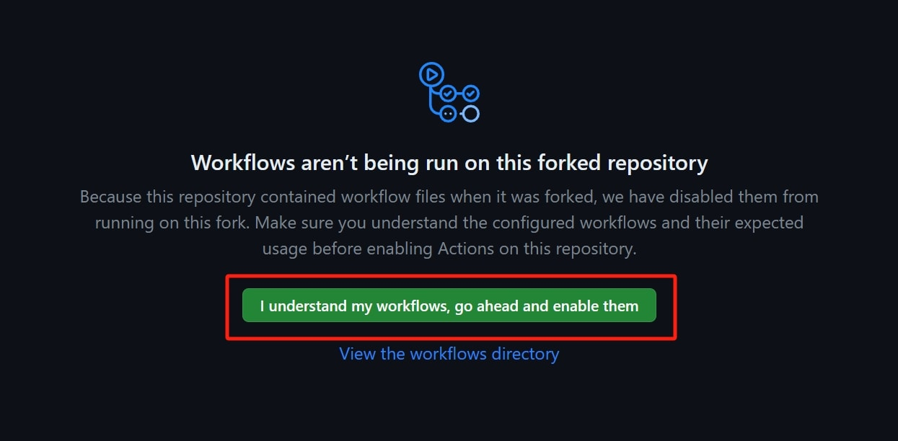
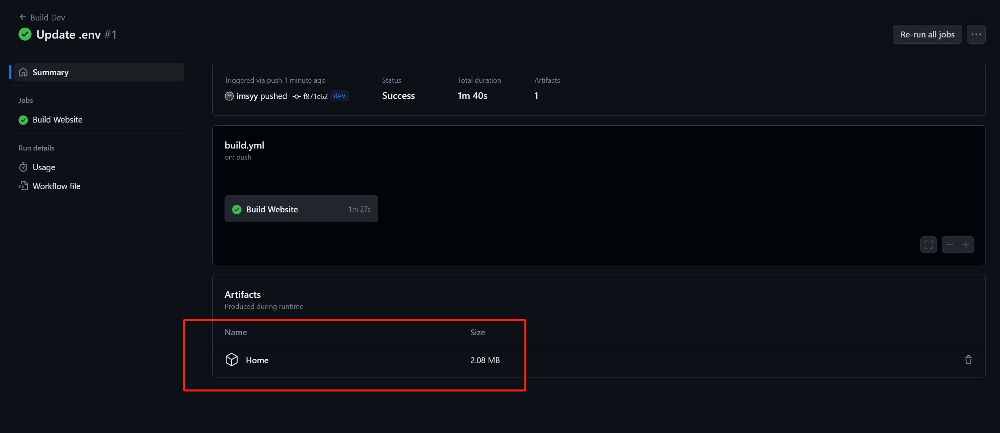

<div align="center">

# imsyy's Homepage (EFU)

**English** | [简体中文](./README.md)

<p>
  <a title="Vue" target="_blank" href="https://vuejs.org/"></a>
  <a title="Vite" target="_blank" href="https://vite.dev/"></a>
  <a title="TypeScript" target="_blank" href="https://www.typescriptlang.org/"></a>
  <a title="Copyright" target="_blank" href="https://nanorocky.top/"></a>
</p>

</div>

> [!IMPORTANT]
> ### To Everyone
> - Hey! Glad you found your way here~ This is the **Extension Function Updates (EFU)** edition maintained by **NanoRocky**, based on the original homepage by [imsyy](https://github.com/imsyy/)! This edition adds word-by-word (verbatim) lyrics, multi-language i18n, a quick search bar, local multi-tab notes, seasonal ambient effects, and continuous dependency & security updates (note: verbatim lyrics and seasonal effects come with moderately higher resource usage).
> - As a Vue beginner driven by passion, NanoRocky teamed up with classmate [Pizero](https://github.com/pizeroLOL/) to refine this project—so the code may not be perfect and might still have undiscovered bugs. Bug reports, suggestions, and PR contributions are always warmly welcome!
> - **Feedback & Support**: Please open a GitHub **Issue** for bug reports or start a GitHub **Discussion** for questions—we will reply when we see them. Unless it is an exceptional matter, **please do NOT DM NanoRocky directly via other social channels**! NanoRocky is not customer support, does not offer one-on-one after-sales service, and simply does not have the bandwidth to answer private messages. Thank you for understanding!
> - **Finally, if you enjoy this project, please give it a ⭐ Star in the top-right corner! Arigato~**

---

## 📸 Screenshots


## 👀 Live Demo

**Demo**:
- [NanoRocky's Homepage](https://nanorocky.top/) *(Note: NanoRocky's personal homepage runs the private branch configuration, so some wallpapers and details differ slightly from the public edition—either private settings or upcoming improvements not yet pushed.)*
- [imsyy's Homepage by EFU](https://imhmpv.main.nanorocky.top/) *(This preview site is automatically synced with the `EFU` branch at all times.)*
- [imsyy's Homepage](https://imsyy.top/) *(Original author's homepage; no longer serves as a reference for this fork.)*

> [!TIP]
> - Because Workbox (PWA) local caching is enabled, you may need to press `Ctrl + F5` to hard-refresh your browser cache after an update to see the latest changes immediately.

---

## 🎉 Features

- [x] **Smooth Loading Animation & Frosted-Glass UI**: Responsive layout across desktop and mobile screens
- [x] **Multi-Language Internationalization (i18n)**: Built-in **简体中文 / English / 日本語**, with automatic browser language detection and optional English site/link titles
- [x] **Multiple Theme Modes**: System, Schedule (time-based), Adaptive (extracted from wallpaper), Light, and Dark modes
- [x] **Seasonal Ambient Effects & Memorial Mourning Mode**: Built-in Winter Snow, Autumn Fireflies, and Spring Lanterns effects
- [x] **Quick Search Bar (`Alt + Q`)**: Instant multi-engine search switching and direct URL navigation
- [x] **Local Multi-Tab Notes (`Alt + N`)**: Create multiple notes saved automatically in browser storage, with JSON import/export, resizable window, and automatic footer lyric avoidance
- [x] **Clock & Time Capsule**: Real-time clock, Hitokoto quotes, day/week/month/year progress bars, and site uptime counter
- [x] **Multi-Provider Live Weather**: Supports Tencent Location Service, AMap (AutoNavi), Google Weather (international), and automatic fallback to keyless APIs
- [x] **Enhanced Music Player & Verbatim Lyrics**:
  - Dual-playlist merging (NetEase Cloud Music / QQ Music) and draggable footer progress bar
  - YRC / QRC word-by-word lyric parsing, enhanced glow animations, and interlude progress dots
  - **AMLL TTML Database** integration (with optional mirror acceleration) and cross-source lyric matching
  - Synchronized translated lyrics, smart stripping of header/footer lyric metadata, and middle-double-click / long-press to restore original lyrics
- [x] **Web Voice Interaction**: Low-latency pre-generated local notification audio + real-time TTS song announcements

### ⌨️ Keyboard & Mouse Shortcuts

| Shortcut / Action | Description |
| :--- | :--- |
| `Alt + Q` | Toggle quick search bar (`Esc` to close) |
| `Alt + N` | Toggle local Notes panel (`PgUp / PgDn` flips pages when music is paused) |
| `Middle-Click` (blank area) | Toggle wallpaper preview mode |
| `Double Middle-Click` / `Long-Press` (footer lyrics) | Discard external-source lyrics and restore original lyrics |

---

## ⚙️ Deployment Guide

> [!TIP]
> - If your deployment environment does not need Workbox local caching (for example, behind a CDN) or if visiting subpaths unexpectedly redirects to the homepage, uncomment these two lines in `vite.config.ts`:
>   ```ts
>   selfDestroying: true,
>   injectRegister: false,
>   ```

### 1. Environment Configuration (Important)

The repository root includes a default configuration template `/.env` (do **not** delete it, or file-integrity protection will block startup).  
To customize your site, **copy `/.env` and rename it to `/.env.local`**, then modify your custom settings inside `/.env.local`.

### 2. Local / Manual Build

1. **Prerequisites** (see `engines` in `package.json`):
   - [Git](https://git-scm.com/)
   - [Node.js](https://nodejs.org/en): `>= 24.22.2 < 25` or `>= 26.13.0`
   - `pnpm`: `>= 12.14.0`

2. **Clone, Install & Build**:

```bash
# Clone only the EFU branch and enter the project directory
git clone -b EFU --single-branch https://github.com/NanoRocky/home.git
cd home

# Enable and activate pnpm via Corepack
corepack enable
corepack prepare pnpm@latest --activate

# Create your local user config file and edit as needed
cp .env .env.local

# Install dependencies
pnpm install

# Start local dev server
pnpm dev

# Build for production
pnpm build
```

> Once built, static assets are output to the **`dist`** directory. Upload everything inside `dist` to Nginx or any static web host.

### 3. Automated Build via GitHub Actions

If your local environment cannot build the project, you can use the included `GitHub Actions` workflow:

1. **Fork** this repository, open the `Actions` tab in your forked repo, and enable workflows if prompted:
   
2. Any commit pushed to the repository will trigger the build workflow. Once finished, download the generated static bundle artifact from the workflow summary page and upload it to your server:
   

### 4. Docker Deployment

The container serves the site on port `12445` by default (place your `.env.local` in the project directory beforehand if you want custom settings baked into the image):

```bash
# Build image
docker build -t home .

# Run container
docker run -p 12445:12445 -d --name home home
```

### 5. One-Click Deployment (Vercel, etc.)

1. Click `Fork` in the top-right corner to copy this repository to your `GitHub` account.
2. Before deploying, either add `.env.local` in your private repo (adjust `.gitignore` accordingly) or edit `/.env` and configure your keys in the platform's Environment Variables settings.
3. Import the repository into Vercel and click `Deploy`.

---

## 🛠️ Customization Guide

### Website Links (`siteLinks.json`)

Customize the navigation cards in `src/assets/siteLinks.json` (you can optionally provide `name_en` for automatic English display when the UI language is non-Chinese):

```json
[
  {
    "icon": "Blog",
    "name": "博客",
    "name_en": "Blog",
    "link": "https://blog.your.domain/"
  }
]
```

To add new icons, browse [xicons](https://www.xicons.org/), import the desired icon component in `src/components/Links.vue`, and register it in `siteIcon`:

```ts
import Blog from "@vicons/fa/es/Blog.js";
import Cloud from "@vicons/fa/es/Cloud.js";

const siteIcon: Record<string, Component> = {
  Blog,
  Cloud,
  // Register newly imported icon components here
};
```

### Social Links (`socialLinks.json`)

Customize social icons, target URLs, and hover tooltips in `src/assets/socialLinks.json` (optional `name_en` and `tip_en` fields are also supported):

```json
[
  {
    "name": "Github",
    "name_en": "GitHub",
    "icon": "/images/icon/github.png",
    "tip": "去 Github 看看",
    "tip_en": "Visit my GitHub",
    "url": "https://github.com/imsyy"
  }
]
```

### Live Weather

Multiple weather providers are supported. Registering a free `Web Service API Key` and adding it to `.env.local` is strongly recommended:

- **Tencent Location Service (Recommended)**: Create an application in the [Tencent Location Service Console](https://lbs.qq.com/), enable WebServiceAPI, and set `VITE_TX_WEATHER_KEY` (supports both IPv4 and IPv6).
- **AMap (AutoNavi) Open Platform**: Create a `Web Service` key in the [AMap Console](https://console.amap.com/dev/index) and set `VITE_GD_WEATHER_KEY` *(Note: AMap's free IP geolocation endpoint does not natively support IPv6; on IPv6-preferred networks it will attempt an IPv4 lookup fallback).*
- **Google Weather**: Ideal for international visitors; set your key in `VITE_GOOGLE_WEATHER_KEY`.

> [!WARNING]
> **Registering and configuring your own weather API key is strongly recommended!**  
> When no key is configured, the app falls back to built-in keyless APIs.<br>
> Because some non-public endpoints lack CORS support, requests must go through a proxy with strict rate limits and may occasionally be throttled or unavailable.<br>
> If you rely on the built-in proxy endpoints over time, please consider sponsoring NanoRocky to help cover server expenses!

### Music Player & Lyrics

Powered by `APlayer` and `Meting-API` for playlist parsing *(default streaming sources primarily target **Mainland China** networks)*.<br>
Configure music parameters in `.env.local`:

```ini
# Meting-API endpoint (self-hosting is strongly recommended)
VITE_SONG_API = "https://metingapi.nanorocky.top/"
# Music platform ( netease: NetEase Cloud Music, tencent: QQ Music )
VITE_SONG_SERVER = "netease"
VITE_SONG_SERVER_SECOND = "tencent"
# Resource type ( song, playlist, album, search, artist )
VITE_SONG_TYPE = "playlist"
# Resource ID (supports merging two playlists; leave empty to disable secondary list or player)
VITE_SONG_ID = "9379831714"
VITE_SONG_ID_SECOND = "9518088898"
```

> [!WARNING]
> - To enable **word-by-word (verbatim) lyrics** and **server-side lyric metadata rules**, please self-host the [Modified Meting-API](https://github.com/NanoRocky/meting-api/)!
> - The public API in the example has strict rate limits and is for demo purposes only—self-hosting is strongly advised (or consider sponsoring NanoRocky to help with server expenses, arigato!).
> - **Note**: Receiving a `401` or `418` status from QQ Music on the public API is not a server outage; you must deploy the compiled frontend to a proper domain with `HTTPS` on standard port `443`.

### Wallpapers & Icons

#### 1. Local Default Wallpapers

Local wallpapers live in `public/images/` (named `background1.avif`, `background2.avif`... for desktop landscape, and `backgroundp1.avif`, `backgroundp2.avif`... for mobile portrait):

1. Update the fallback counts in `src/components/Background.vue` (ensure your actual image count is never lower than these defaults):
   ```ts
   let bgImageCount = 10; // Fallback PC wallpaper count
   let bgImageCountP = 3; // Fallback mobile wallpaper count
   ```
2. Update `public/images/config.json`:
   ```json
   {
     "bgImageCount": 10,
     "bgImageCountP": 3
   }
   ```
   Afterwards, adding or removing local wallpapers only requires updating `public/images/config.json`—no rebuild needed!<br>
- Warning: Always ensure the actual number of wallpaper files is not less than the built-in fallback count.

#### 2. Site Icons

Replace Favicon, Logo, Apple Touch Icon, and social icons inside `public/images/icon/`, or customize their paths in `.env.local`.

### Web Voice Interaction

- **Pre-generated Local Audio**: Stored under `public/speechlocal/` for fixed UI notifications with minimal latency. Replace the `.mp3` files as needed (serving via CDN or browser caching is recommended).
- **Real-time TTS Audio**: Used to announce artist and song titles dynamically. Self-host a TTS endpoint and set `VITE_TTS_API` in `.env.local`. If you use Azure Speech, you can deploy [AzureSpeechAPI-by-PHP](https://github.com/NanoRocky/AzureSpeechAPI-by-PHP) out of the box.

### More Default Switches

Fields marked with `【开关】` inside `storeState` in `src/store/index.ts` control default behaviors, for example:

```ts
coverType: 0 as number,            // Default wallpaper type (0: Default, 1: Bing Daily, 2: Scenery, 3: Anime)
autoBGSwitchInterval: 2 as number, // Auto wallpaper switch interval (0: Off, 1: 15s, 2: 30s, 3: 45s)
seasonalEffects: true,             // Seasonal ambient effects
mourningMode: true,                // Memorial day grayscale mourning mode
playerAutoplay: true,              // Music autoplay
playerDWRCShow: true,              // Verbatim lyric parsing master switch
webSpeech: true,                   // Web voice interaction master switch
socialTipPosition: "right",        // Social link tooltip position ("right" | "down")
```

> Note: Settings persisted in `localStorage` apply new defaults only to **first-time visitors**. Clients that have visited before must click **Reset All** in Settings, visit `?set=reset`, or clear browser site data to pick up updated defaults immediately.

### Fonts

Uses split web fonts (`MiSans` and `HarmonyOS Sans`) for fast loading and clean typography:

- `https://cdn-font.hyperos.mi.com/font/css?family=MiSans_VF:VF:Chinese_Simplify,Latin&display=swap`
- `https://s1.hdslb.com/bfs/static/jinkela/long/font/regular.css`

---

## 🧰 Tech Stack & APIs

### Tech Stack

- [Vue 3](https://vuejs.org/) · [Vite](https://vite.dev/) · [TypeScript](https://www.typescriptlang.org/) · [Pinia](https://pinia.vuejs.org/)
- [Element Plus](https://element-plus.org/) · [UnoCSS](https://unocss.dev/) · [Vue I18n](https://vue-i18n.intlify.dev/) · [Swiper](https://swiperjs.com/)
- [APlayer](https://aplayer.js.org/) · [AppleMusic-like Lyrics](https://github.com/Steve-xmh/applemusic-like-lyrics) · [IconPark](https://iconpark.oceanengine.com/official) · [xicons](https://xicons.org/)

### External APIs & Services

- [Tencent Location Service](https://lbs.qq.com/) · [AMap Open Platform](https://lbs.amap.com/) · [Google Maps Platform](https://developers.google.com/maps/documentation/weather)
- [Oioweb API](https://api.oioweb.cn/) · [UAPIs](https://uapis.cn/) · [Moehu API](https://img.moehu.org/)
- [Hitokoto](https://hitokoto.cn/) · [Meting API](https://github.com/injahow/meting-api/) · [Meting API (NanoRocky Fork)](https://github.com/NanoRocky/meting-api/)

---

## 📈 Star History

[](https://star-history.com/#imsyy/home&Date)

## 💖 Special Thanks

- [AMLL TTML Database](https://github.com/Steve-xmh/amll-ttml-db)
- [Meting API](https://github.com/injahow/meting-api)

### Thanks to the Original Author & Contributors!

- [imsyy](https://github.com/imsyy/) (Original Author)
- [Pizero](https://github.com/pizeroLOL/) (这个哔养得)

---

<div align="center">
  <a title="CDN" target="_blank" href="https://www.cloudflare.com/"></a>&nbsp;
  <a title="CDN2" target="_blank" href="https://edgeone.ai/"></a>&nbsp;
  <a title="Copyright" target="_blank" href="https://nanorocky.top/"></a>
</div>
